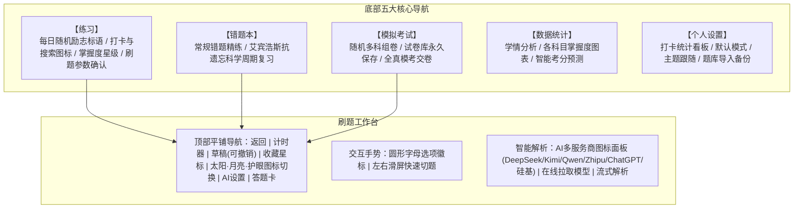

# file2quiz - 智能刷题与AI解析实施计划 (Plan)

本项目旨在将各类考试真题与题库文档（PDF）快速解析为现代化的轻量 PWA 移动端刷题应用。已全面升级为 **file2quiz**，采用**纯扁平化冷色系风格（无渐变、无阴影、杜绝任何 Emoji）**，集成五大核心专区、双做题模式、AI 多供应商面板与在线模型拉取、左右滑屏切题与可撤销草稿板。

---

## 一、 系统架构与模块设计

---

## 二、 核心迭代功能明细

1. **主页面纯净与顶部功能**：
   - 首页彻底移除“file2quiz”冗余文字标头，改为**每日精选励志鼓励标语**（随机循环激励备考状态）；
   - 右上角提供 **【每日打卡图标】**（未打卡带精致提示红点）与 **【全局搜索图标】**（毫秒级检索 1100 道真题与解析）。
2. **个人中心打卡统计数据**：
   - 个人设置页专属打卡数据卡片：直观显示**连续打卡天数**、**累计打卡总天数**；
   - 提供近 7 天每日打卡状态点阵图，记录学习轨迹。
3. **全新 AI 供应商面板与模型管理**：
   - **品牌图标矩阵**：优先横向展示 DeepSeek、Kimi、通义千问(Qwen)、智谱(Zhipu)、ChatGPT、硅基流动(SiliconFlow)、自定义供应商图标卡片；
   - **API 网址默认预填**：点击对应供应商后弹出具体配置抽屉，默认预填官方 API Base URL；
   - **在线拉取模型列表**：支持一键向当前供应商 `/models` 接口发送请求，在线获取最新可用模型；
   - **模型搜索与即选切换**：支持对拉取到的模型列表进行关键词搜索与即点切换，同时提供官方推荐默认模型保底。
4. **图标完整度与防裁剪重构**：
   - 全局 SVG 图标统一声明 `viewBox="0 0 24 24"`，并应用 `overflow: visible;`；
   - 路径坐标严格收敛在安全边界内，彻底解决各分辨率屏幕与设备上图标右侧和下方显示不全、边缘被切的问题。
5. **刷题前参数确认与乱序模式**：
   - 每次点击科目或【继续上次 ›】均弹出参数确认卡片：
     - 清晰提示并支持切换：【背题模式】 vs 【做题模式】；
     - 题量选择：5题 / 10题 / 15题 / 20题 / 不限；
     - **随机乱序出题模式**：打破固有刷题顺序，增强临场应对能力。
6. **顶栏主题专属图标**：
   - 纯白日间：太阳图标 SVG (`#icon-sun`)；
   - 护眼豆沙绿：护眼眼睛图标 SVG (`#icon-eye`)；
   - 极客深色：月亮图标 SVG (`#icon-moon`)；
   - 点击即时轮换并更新图标。
7. **学情看板与智能考分预测**：
   - 统计总刷题数、累计正确率、连续打卡天数；
   - 基于做题大数据给出 **100 分制 AI 智能综合预估分** 与考评等级（优秀/良好/及格/起步）；
   - 各科目横向进度条直观展示已完成比例与掌握度。
8. **题库导入与备份**：
   - 支持外部自定义题库 JSON 文件一键导入，持续更新题库；
   - 支持完整题库与进度备份导出。
