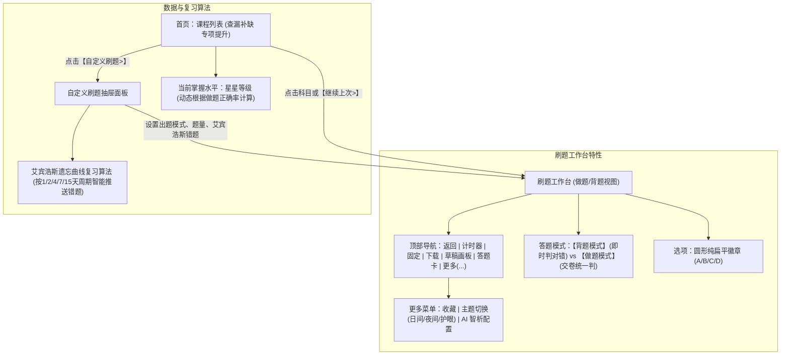

# 笃学题库 (file2quiz) - 全面粉笔 UI 与功能升级规划 (Plan)

本项目旨在将教资与公考等题库文档（PDF）转化为极致体验的移动端刷题 App。本次升级深度参考**粉笔 App**的设计语言与核心功能，彻底移除所有 Emoji，使用精美 SVG 矢量图标，增加课程列表、掌握度星级、背题/做题双模式、草稿纸、艾宾浩斯遗忘曲线错题复习等专业功能。

---

## 一、 界面与功能架构 (粉笔 App 深度复刻)

---

## 二、 核心功能模块明细

### 1. 课程列表页 (参考截图 2)
- **头部与标题**：“查漏补缺 专项提升”，右上角包含日历打卡、全局检索、错题集 SVG 按钮。
- **科目列表卡片**：
  - 展开/选中圆标、科目名称。
  - **掌握度星级评分**：基于用户在该科目的做题正确率动态点亮 1~5 颗星。
  - **做题进度展示**：例如 `35/220` 已完成进度。
  - **【继续上次 >】** 快捷入口：一键直达上次离开的题号。
- **底部浮动胶囊**：【自定义刷题 ▶】呼出模态弹窗。
- **底部专业导航栏**：【练习】、【课程】、【艾宾浩斯错题】、【设置/关于】。

### 2. 自定义刷题弹窗 (参考截图 3)
- **出题模式切换**：
  - **【做题模式】**：模拟真实考试，做题过程隐藏答案，作答完毕后统一提交交卷并给出成绩报告。
  - **【背题模式】**：点选选项即时判断对错、标出正确答案并展示详细解析与考点。
  - 采用粉笔风格的圆角矩形卡片，选中带有右上角蓝色小三角对勾。
- **题量灵活配置**：
  - 快捷选择：5 题 / 10 题 / 15 题 / 20 题 / 不限。
- **艾宾浩斯遗忘曲线回顾模式**：
  - 根据做题历史记录的时间戳（1天、2天、4天、7天、15天周期），精准提取遗忘临界点的错题组。

### 3. 刷题详情页顶部导航与工具栏 (参考截图 1)
- **左侧**：
  - `✕` 返回/关闭：保存进度并返回科目列表。
  - ⏱ 计时器：正向计时 `00:03`，可暂停/继续。
- **右侧工具栏（纯 SVG 矢量图标，杜绝 Emoji）**：
  - 📌 **固定模式**：固定题目状态指示。
  - ⬇ **离线状态**：显示 Service Worker 离线状态。
  - ✏️ **草稿纸画板**：点击呼出半透明全屏画板，支持单指划线做草稿、笔迹清除与一键收起。
  - 📋 **答题卡**：网格答题卡抽屉，已答/未答/正误一览并支持点击跳转。
  - `···` **更多菜单**：
    - ★ 收藏题目
    - 🎨 主题模式切换（日间纯白 / 护眼豆沙绿 / 极客深色）
    - 🤖 AI 智能解析配置（DeepSeek 等）

### 4. 视觉设计系统
- **严禁使用 Emoji**：所有按钮、状态、星级全部采用高精度 SVG 矢量绘制。
- **App 名称与图标**：命名为 **“笃学题库”**，设计书卷与勾选合一的专属扁平 SVG 图标。
- **粉笔 App 配色体系**：
  - 品牌主蓝：`#2563eb` / `#1d4ed8`
  - 浅蓝底衬：`#eff6ff`
  - 选项灰色常态：`#f8fafc`，边框 `#e2e8f0`
  - 正确绿：`#10b981`
  - 错误红：`#ef4444`

---

## 三、 实施与交付步骤
1. **GitHub 同步**：先推送当前版本至 `Simple53/file2quiz`（已完成）。
2. **更新 plan.md**：明确技术路径与交互细节（当前步骤）。
3. **前端深度重构与功能落地**：
   - 制作全新的 SVG 图标库（包含草稿笔、时钟、星星、更多、答题卡等）。
   - 实现课程列表页与刷题工作台的平滑切换路由。
   - 实现全屏草稿纸 Canvas 交互。
   - 实现【做题模式】（交卷报告卡）与【背题模式】逻辑。
   - 实现掌握度星级计算与艾宾浩斯遗忘曲线推荐算法。
   - 增加多套主题色支持（日间、护眼绿、暗色）。
4. **更新 README.md 与提交推送**：
   - 全面更新功能说明与使用指南，推送到 GitHub 仓库。
