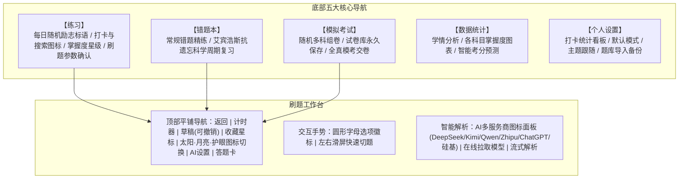

# file2quiz - 智能刷题与AI解析实施计划 (Plan)

本项目旨在将各类考试真题与题库文档（PDF）快速解析为现代化的轻量 PWA 移动端刷题应用。已全面升级为 **file2quiz**，采用**纯扁平化冷色系风格（无渐变、无阴影、杜绝任何 Emoji）**，集成五大核心专区、双做题模式、AI 多供应商面板与在线模型拉取、左右滑屏切题与可撤销草稿板。

---

## 一、 系统架构与模块设计

---

## 二、 核心迭代功能明细

1. **答题工作台顶部 AI 配置与一键解析**：
   - 将 AI 供应商与当前激活模型配置条**上移至题目正上方**，一目了然显示当前服务商（DeepSeek/Kimi/Qwen/ChatGPT 等）与模型名称；
   - 点击该配置条随时呼出参数配置抽屉修改 API Key、在线刷新模型或切换模型；
   - 答案解析区保留**一键 AI 深度考点解析**，支持流式打字深度精讲与重新解析；
   - **全面清除代码与 UI 中的所有 Emoji 字符**，100% 采用专业原生 SVG 矢量图标。
2. **首页每日动态汇总与金句轮播 Banner**：
   - 首页顶部新增**支持手势左右滑动的交互式 Banner**（支持触摸滑动、自动轮播与圆点指示器）；
   - 聚合呈现**最新重要会议精神**（如 2024 全国教育大会、教育家精神文件、中央政治局教育强国部署）与**重要论述每日金句**；
   - 点击卡片弹出全屏详情弹窗，深入研读会议原文、重要讲话全文及**高校教资与综合素质考试核心考点结合解析**，支持一键复制。
3. **主页面纯净与顶部功能**：
   - 首页顶栏采用日期状态与纯矢量 Icon 紧凑布局；
   - 右上角提供 **【每日打卡图标】**（未打卡带未完成提示红点）与 **【全局搜索图标】**（毫秒级检索 1100 道真题与解析）。
4. **个人中心打卡统计数据**：
   - 个人设置页专属打卡数据卡片：直观显示**连续打卡天数**、**累计打卡总天数**；
   - 提供近 7 天每日打卡状态点阵图，记录学习轨迹。
5. **全新 AI 供应商面板与模型管理**：
   - **品牌图标矩阵**：支持 DeepSeek、Kimi、通义千问(Qwen)、智谱(Zhipu)、ChatGPT、硅基流动(SiliconFlow)与自定义(Custom)供应商卡片；
   - **API 网址默认预填**：点击对应供应商后弹出具体配置抽屉，默认预填官方 API Base URL；
   - **在线拉取模型列表**：支持一键向当前供应商 `/models` 接口发送请求，在线获取最新可用模型；
   - **模型搜索与即选切换**：支持对拉取到的模型列表进行关键词搜索与即点切换。
6. **网络访问与公网部署架构**：
   - **局域网访问排查**：剖析校园网/公共 Wi-Fi（如 NNU-WiFi6）交换机默认开启 AP 隔离（Client Isolation）导致同 WiFi 无法互访的根源，提供电脑开启“移动热点”手机直连的稳定解决方案；
   - **非局域网公网方案（GitHub Pages）**：提供基于 GitHub Actions 自动化部署流水线，生成永久免费全球 HTTPS 公网链接，无需局域网、无需电脑开机，手机利用 4G/5G 随时随地秒开，并能原生添加到主屏幕离线刷题。
