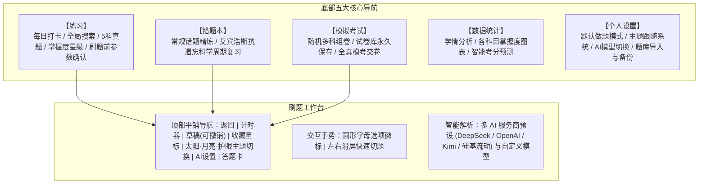

# file2quiz - 智能刷题与AI解析实施计划 (Plan)

本项目旨在将教资与各类考试题库文档（PDF）快速解析为现代化移动端刷题 App。已全面升级为 **file2quiz**，采用**纯扁平化冷色系风格（无渐变、无阴影、杜绝任何 Emoji）**，集成五大核心专区、双做题模式、多 AI 服务商与模型自由切换、左右滑屏切题与可撤销草稿板。

---

## 一、 系统架构与模块设计

---

## 二、 最新迭代功能明细

1. **主页面纯净与顶置功能**：
   - 首页头部留白，彻底移除“file2quiz”冗余文字；
   - 顶部增加 **【每日打卡】**（记录连续学习天数）与 **【全局题目搜索】**（毫秒级模糊检索 1100 题与解析）。
2. **刷题前参数确认与乱序模式**：
   - 每次点击科目或【继续上次 ›】均弹出参数确认卡片：
     - 清晰提示并支持切换：【背题模式】 vs 【做题模式】；
     - 题量选择：5题 / 10题 / 15题 / 20题 / 不限；
     - **随机乱序出题模式**：打破固有刷题顺序，增强临场应对能力。
3. **顶栏主题专属图标**：
   - 纯白日间：太阳图标 SVG (`#icon-sun`)；
   - 护眼豆沙绿：护眼眼睛图标 SVG (`#icon-eye`)；
   - 极客深色：月亮图标 SVG (`#icon-moon`)；
   - 点击即时轮换并更新图标。
4. **学情看板与智能考分预测**：
   - 统计总刷题数、累计正确率、连续打卡天数；
   - 基于做题大数据给出 **100 分制 AI 智能综合预估分** 与考评等级（优秀/良好/及格/起步）；
   - 各科目横向进度条直观展示已完成比例与掌握度。
5. **个人设置中心**：
   - 设置默认做题模式（背题 vs 做题）；
   - 设置外观主题是否自动跟随手机系统暗黑模式；
   - AI 多模型接入与流式精讲；
   - **外部题库导入 (JSON)** 与当前题库一键导出备份。
