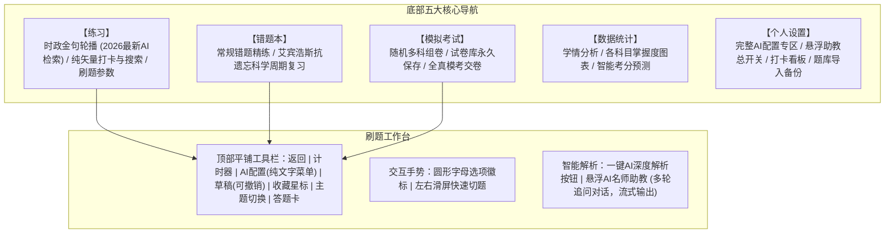

# file2quiz - 智能刷题与AI解析实施计划 (Plan)

本项目旨在将各类考试真题与题库文档（PDF）快速解析为现代化的轻量 PWA 移动端刷题应用。已全面升级为 **file2quiz**，采用**纯扁平化冷色系风格（无渐变、无阴影、杜绝任何 Emoji）**，集成五大核心专区、双做题模式、AI 多供应商管理、顶部纯文字名称切换、悬浮 AI 名师助教多轮对话、左右滑屏切题与可撤销草稿板。

---

## 一、 系统架构与模块设计

---

## 二、 核心迭代功能明细

1. **时政金句时效与 AI 联网检索**：
   - 彻底去除过去写死的历史年份日期（避免 2026 年看到老旧日期违和），采用“新时代金句”、“重要政策文件”、“高等教育龙头”等专题标签；
   - 首页顶栏提供刷新/检索按钮，支持调用当前配置的 AI 模型在线联网提取针对 2026 年高校教资与新时代教育强国建设最新的重要会议论述与核心金句；若未配置 Key 则进行本地经典论述智能置顶轮换。
2. **做题模式顶栏 AI 配置与纯文字名称菜单**：
   - AI 配置作为做题模式最上方一排的图标之一（芯片图标），与草稿、收藏、主题、答题卡平铺排列；
   - 点击该图标展开下拉菜单，快速切换供应商与模型；
   - **严格按照规范：菜单内不需要显示 icon，全部采用清晰干练的纯文字名称按钮**（点击即可高亮切换）；
   - 提供“详细设置”按钮，一键直达底部设置板块的完整配置区。
3. **精简一键解析按钮与悬浮 AI 名师助教（多轮对话）**：
   - 题目下方去除粗笨大容器，精简为一个现代胶囊按钮【一键 AI 深度解析与助教追问】；
   - 支持右下角悬浮 AI 助教球与半屏多轮对话抽屉（Multi-turn Chat）；
   - 点击解析按钮或悬浮球，自动注入当前题目的题干、选项、正确答案与官方考点，首轮自动生成深度剖析（考点本质、正解与混淆项拆解、秒记口诀）；
   - 支持多轮自由追问（如“为什么不选B？”、“这个知识点怎么区分？”），大模型结合上下文打字机流式输出；
   - 支持最小化收起与清空对话；
   - **支持开启/关闭**：在个人设置中提供全局开关，关闭后隐藏悬浮球与抽屉。
4. **下方导航栏【设置】板块内置完整 AI 配置**：
   - 在 Tab 5 个人设置板块中内置完整的 AI 大模型配置面板；
   - 包含供应商纯文字切换按钮（DeepSeek、Kimi、通义千问、智谱、ChatGPT、硅基流动、自定义）；
   - 支持编辑 API 端点（Base URL）与 API 密钥（API Key）；
   - 支持点击【在线获取模型】（请求 `/models` 接口）拉取最新可用模型；
   - 支持模型关键词搜索过滤与即点选定；
   - 提供悬浮 AI 助教（多轮对话）全局启用/停用开关；
   - 一键保存并激活当前供应商，配置持久保存在手机本地。
5. **网络访问与公网部署架构**：
   - **局域网访问排查**：剖析校园网/公共 Wi-Fi（如 NNU-WiFi6）交换机默认开启 AP 隔离（Client Isolation）导致同 WiFi 无法互访的根源，提供电脑开启“移动热点”手机直连的稳定解决方案；
   - **非局域网公网方案（GitHub Pages）**：提供基于 GitHub Actions 自动化部署流水线，生成永久免费全球 HTTPS 公网链接，无需局域网、无需电脑开机，手机利用 4G/5G 随时随地秒开，并能原生添加到主屏幕离线刷题。
